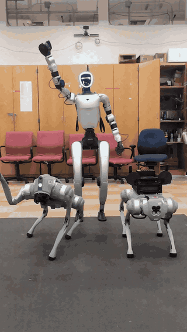
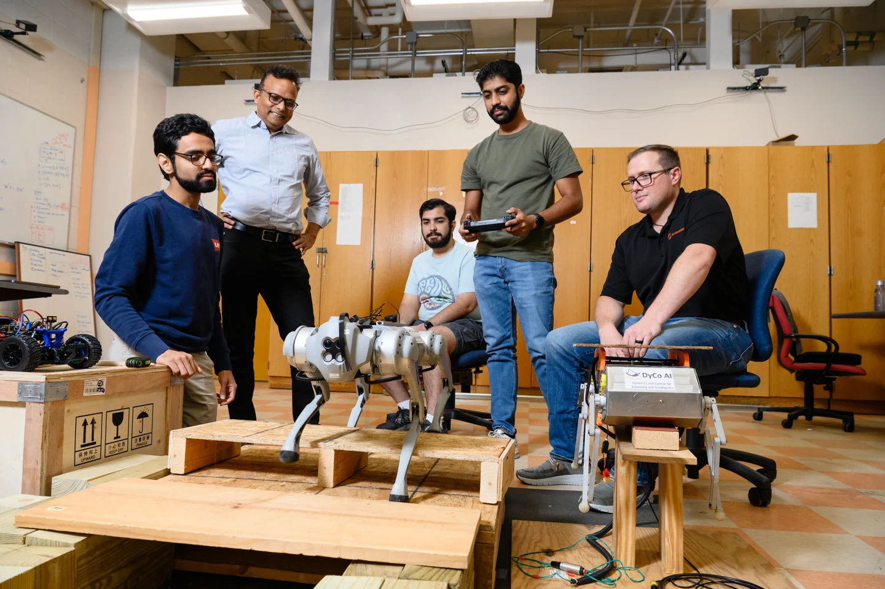

# DyCo-AI Lab Robots

**Meet the robots. Build your first experiment.**

The public robot handbook for the **DyCo-AI Lab at Clemson University**: a
practical starting point for students to understand a robot, connect to it,
inspect its sensors, and build on a maintained example.

**[Open the handbook](https://dyco-ai.github.io/lab-robots/)** ·
[Start here](docs/getting-started.md) · [Go2](docs/go2/index.md) ·
[G1](docs/g1/index.md) · [Go1](docs/go1/index.md) · [Contribute](CONTRIBUTING.md)

<p align="center">
  
  <br><em>Meet Wobby (Go1), Widget (Go2 EDU), and Evan Wobbier (G1).</em>
</p>

## Start your first lab session

1. Read [First lab session](https://dyco-ai.github.io/lab-robots/getting-started/) for access, preparation, and the supervised first checkout.
2. Choose a robot and connection path below, then follow its maintained code repository.
3. Start with network and read-only feedback, record what works on your assigned unit, and extend the example with the instructor.

| Robot | Starting point |
| --- | --- |
| **Widget / Go2 EDU** | [Windows and WebRTC](https://dyco-ai.github.io/lab-robots/go2/webrtc/) for camera/voxels and high-level Python applications; [Ethernet and ROS 2](https://dyco-ai.github.io/lab-robots/go2/ros/) for onboard Jetson development and bags |
| **Evan Wobbier / G1** | [ROS 2 first connection](https://dyco-ai.github.io/lab-robots/g1/ros/) and [sensor diagnostics](https://dyco-ai.github.io/lab-robots/g1/sensors/) on Ubuntu with Rerun |
| **Wobby / Go1** | [Existing Go1 resources](https://dyco-ai.github.io/lab-robots/go1/); setup notes currently require lab access |

## Code and detailed runbooks

This repository owns onboarding, route selection, and links to the maintained
robot runbooks. Executable examples and detailed installation instructions live
in independent repositories:

| Robot / path | Code and detailed runbooks |
| --- | --- |
| Go2 Ethernet / Jetson / ROS 2 | [go2-ros](https://github.com/DyCo-AI/go2-ros) |
| Go2 Windows 11 / Wi-Fi / Basic WebRTC | [go2-webRTC](https://github.com/DyCo-AI/go2-webRTC) |
| G1 Ubuntu / ROS 2 / diagnostics | [g1-ros2](https://github.com/DyCo-AI/g1-ros2) |
| Go1 | [go1_info](https://github.com/DyCo-AI/go1_info) — existing setup notes; requires lab repository access |

For the Clemson Creative Inquiry learning path, see
[Courses and projects](https://dyco-ai.github.io/lab-robots/learning/), the
[simulation and student code](https://github.com/sriram-2502/go1-mujoco-playground),
and the [Go2 gesture-navigation instructor reference](https://github.com/sriram-2502/go2-gesture-nav).
The lab starters remain independent of those course applications.

## Publishing and local preview

GitHub Pages publishes **main → /docs** using Jekyll. There is no separate
deployment branch or Node build. The site has a responsive sidebar, a page
finder, connection diagrams, and direct links to the source repositories.

With Ruby, Bundler, and the Gemfile dependencies installed:

```bash
bundle install
bundle exec jekyll serve --source docs --baseurl /lab-robots
```

Open `http://127.0.0.1:4000/lab-robots/`. For a build only, use
`bundle exec jekyll build --source docs`.

No passwords, AES keys, account recovery material, or full experiment recordings
belong in this public repository. Request credentials privately from the lab
maintainer. Proton Pass migration is planned; the shared vault is not yet live.

## Learning together in the lab

Our goal is to make robotics approachable: start with a clear example, ask
questions, and turn a first connection into an experiment you can explain and
build on. This handbook helps each new group carry that work forward.



Developed by [Sriram Krishnamoorthy](https://github.com/sriram-2502) for lab
onboarding and handover. Lab-authored material uses the existing [MIT license](LICENSE).
See [sources](docs/sources.md) for linked media and upstream attribution.
